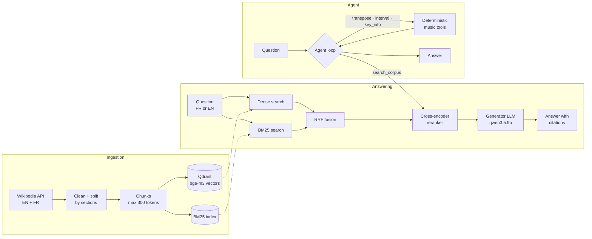

# MusicTeacher (RAG)

[](https://github.com/Antoine-GourdonHuet/musicteacher-rag/actions/workflows/ci.yml)

A bilingual (French / English) retrieval-augmented assistant for music theory, guitar and singing,
built as a **controlled experiment**: which retrieval design actually makes the answers more correct
and more faithful to their sources, and do deterministic tools fix what retrieval cannot?

Everything runs locally and for free: open models served by [Ollama](https://ollama.com), embeddings
and reranker on a laptop GPU (8 GB), a Wikipedia corpus, and an evaluation pipeline whose numbers
are all generated from result files.

New here? Follow the [tutorial](#tutorial-from-zero-to-your-first-answer) to ask your first question.

## Why

LLMs used as learning assistants make two kinds of mistakes in music theory:

- **they invent facts** in a specialised domain (asked about the Dorian mode without context, the
  generator used here described it as "a communication style");
- **they compute unreliably** (transposing a chord progression, naming an interval).

Retrieval-augmented generation (RAG) targets the first problem, tools target the second. Music theory
is a good test bed: questions mix exact symbols ("V7/ii", "Dorian") that favour keyword search with
conceptual questions that favour semantic search, and here questions and sources are in two languages.

## Research questions

| | Question | Hypothesis | Outcome |
|---|---|---|---|
| RQ1 | Does hybrid search + reranking beat dense search alone? | H1: hybrid > dense on recall | **Not supported**: hybrid is not better than dense here (row C3 − C1) |
| RQ2 | Which component helps most: hybrid fusion or reranking? | H2: reranking adds precision | **Supported**: the reranker improves MRR and correctness over hybrid (row C4 − C3) |
| RQ3 | Do deterministic tools beat RAG on computation questions? | H3: tools > RAG-only | **Supported**, once the agent is made to actually call its tools (C5b) |
| RQ4 | Does retrieval keep its quality across languages? | H4: cross-lingual recall is lower | **Trend only**: cross-lingual misses dominate the error analysis, but the subset is too small for a conclusion |

## Results

<!-- results:start -->
<!-- Generated by `python -m musicteacher.evaluation.report --readme`. Do not edit. -->

Corpus: 376 Wikipedia articles, 4886 chunks (3208 EN / 1678 FR), 972,377 tokens. Evaluation set: 73 questions. Mean and 95% bootstrap confidence interval.

| Condition | Recall@5 | MRR@10 | Correctness | Faithfulness |
|---|---|---|---|---|
| C0 (no retrieval) | – | – | 0.70 [0.60, 0.80] | – |
| C1 (dense) | 0.92 [0.84, 0.98] | 0.81 [0.72, 0.90] | 0.73 [0.63, 0.83] | 0.79 [0.67, 0.89] |
| C2 (bm25) | 0.71 [0.58, 0.82] | 0.65 [0.53, 0.77] | 0.62 [0.51, 0.73] | 0.77 [0.64, 0.87] |
| C3 (hybrid) | 0.86 [0.76, 0.94] | 0.73 [0.63, 0.83] | 0.70 [0.60, 0.79] | 0.77 [0.65, 0.88] |
| C4 (hybrid_rerank) | 0.89 [0.80, 0.96] | 0.83 [0.74, 0.90] | 0.80 [0.71, 0.88] | 0.83 [0.72, 0.92] |
| C5 (agent) | 0.48 [0.34, 0.62] | 0.45 [0.32, 0.58] | 0.81 [0.72, 0.89] | 0.42 [0.28, 0.55] |
| C5b (agent) | 0.83 [0.73, 0.92] | 0.77 [0.67, 0.87] | 0.94 [0.88, 0.99] | 0.65 [0.52, 0.79] |

Paired differences on the same questions (A − B, 95% CI; ** = the interval excludes 0):

| Comparison | Recall@5 | Correctness | Faithfulness |
|---|---|---|---|
| C3 − C1: H1 hybrid vs dense | -0.06 [-0.15, +0.03] | -0.03 [-0.12, +0.05] | -0.02 [-0.14, +0.10] |
| C4 − C3: H2 reranker on top of hybrid | +0.03 [-0.04, +0.09] | +0.10 [+0.02, +0.19] ** | +0.08 [-0.04, +0.19] |
| C4 − C1: RQ1 hybrid + reranker vs dense | -0.03 [-0.10, +0.04] | +0.07 [-0.03, +0.16] | +0.04 [-0.10, +0.17] |
| C1 − C0: retrieval vs no retrieval | – | +0.03 [-0.09, +0.15] | – |
| C5b − C4: agent (tool required) vs RAG-only | -0.06 [-0.15, +0.02] | +0.14 [+0.04, +0.24] ** | -0.17 [-0.35, +0.00] |
| C5b − C5: tool required vs free choice | +0.35 [+0.22, +0.48] ** | +0.13 [+0.06, +0.21] ** | +0.23 [+0.12, +0.35] ** |

Computation questions (transposition, interval, key), correctness and tool use:

| Condition | Correctness | Tool selection | Tool arguments |
|---|---|---|---|
| C0 (no retrieval) | 0.65 [0.45, 0.85] | – | – |
| C1 (dense) | 0.30 [0.10, 0.50] | – | – |
| C2 (bm25) | 0.20 [0.05, 0.40] | – | – |
| C3 (hybrid) | 0.35 [0.15, 0.60] | – | – |
| C4 (hybrid_rerank) | 0.55 [0.35, 0.75] | – | – |
| C5 (agent) | 0.95 [0.85, 1.00] | 0.60 [0.40, 0.80] | 0.60 [0.40, 0.80] |
| C5b (agent) | 1.00 [1.00, 1.00] | 1.00 [1.00, 1.00] | 1.00 [1.00, 1.00] |

Judge sanity check (ministral-3:8b): planted fabrications caught 20/20, verbatim answers accepted 20/20, swapped answers caught 20/20.
<!-- results:end -->

Conditions: **C0** the generator alone, no retrieval · **C1** dense retrieval (bge-m3) · **C2** BM25 ·
**C3** hybrid (dense + BM25 fused with Reciprocal Rank Fusion) · **C4** hybrid + cross-encoder reranker ·
**C5** agent with tools (search + music tools), free to choose · **C5b** same agent, asked once to call a
tool when it first answers from memory. Same generator, prompt, temperature (0) and `top_k` (5) everywhere.

**Reading the table honestly**

- **Dense retrieval is already strong.** Adding BM25 through RRF does not help: BM25 alone is clearly
  weaker, cannot match across languages, and dilutes the dense ranking. Hypothesis H1 is not supported.
- **The reranker is the retrieval component that pays off**: on top of hybrid search it improves both the
  rank of the right passage (MRR) and answer correctness, with confidence intervals that exclude 0.
- **Retrieval alone barely beats no retrieval on overall correctness**: the generator already knows basic
  theory. Retrieval helps most on terminology and definitions (see the per-type tables in
  [`evals/results/report.md`](evals/results/report.md)).
- **Retrieval hurts computation questions**: with passages in front of it, the generator answers "the
  passages do not say" instead of transposing. Tools fix this. A free-choice agent (C5) often skipped its
  tools and answered from memory; requiring a tool call (C5b) makes tool selection and arguments correct
  and gives the best overall correctness of all conditions.
- **Faithfulness of C5b stays below C4**: when the agent first answers from memory, that answer stays in
  the conversation and is sometimes repeated after the search (see Limitations).
- Wide intervals mean small samples: differences whose interval contains 0 are reported as "no
  measurable difference", not as wins.

Full report with per-language, per-type, cross-lingual and dev vs held-out breakdowns:
[`evals/results/report.md`](evals/results/report.md). Error analysis: [`docs/ERROR_ANALYSIS.md`](docs/ERROR_ANALYSIS.md).

## Architecture



**Evaluation**: questions drafted from corpus passages → filtered and verified → frozen set with a
held-out split → one run per condition (retrieval → generation → judging) → JSON files in
`evals/results/` → generated report and the table above.

## How it works

| Step | Choice | Why |
|---|---|---|
| Corpus | Wikipedia EN + FR through the official API, frozen topic list ([`data/topics.csv`](data/topics.csv)), every source in [`data/sources.csv`](data/sources.csv) with licence and revision id | Reproducible, licensed (CC BY-SA), bilingual pairs for cross-lingual questions |
| Chunking | Section-aware: whole paragraphs up to 300 bge-m3 tokens, never across a section boundary | Compared with fixed windows: far fewer chunks cut mid-sentence ([`compare_chunking.py`](src/musicteacher/ingestion/compare_chunking.py)) |
| Indexed text | `"Title — Section"` + chunk text | A chunk keeps the context it came from |
| Dense retrieval | `BAAI/bge-m3`, Qdrant (local mode), cosine | Multilingual: a French question can find an English passage |
| Sparse retrieval | BM25 (`bm25s`), FR + EN stopwords, **one-letter tokens kept** | Note names C, D, E are single letters; default stopword lists removed "a", "c", "d" |
| Fusion | Reciprocal Rank Fusion, k = 60 | Uses ranks only, so cosine and BM25 scores need no normalisation |
| Reranking | `BAAI/bge-reranker-v2-m3` cross-encoder on the top 20 | Reads question and passage together: precise but too slow for the whole corpus |
| Generation | `qwen3.5:9b` via Ollama, temperature 0, one prompt for C1-C4: answer only from the passages, cite `[n]`, say when they do not contain the answer | Local and free; one variable changes at a time |
| Agent | Ollama native tool calling; tools validated with pydantic, errors returned to the model as text, max 4 turns, deterministic fallback | Computations must be exact and testable |
| Judge | `ministral-3:8b` (another model family than the generator), temperature 0, two calls: correctness vs reference, then the list of claims unsupported by the passages | Limits self-preference; a list of claims cannot hide behind a vague score |
| Statistics | Bootstrap 95% CIs, **paired** differences on the same questions | Small sample: say what is and is not distinguishable |

Every LLM call is cached on disk, so a re-run reproduces the same outputs without recomputing them.
Unit tests use fake LLM clients and fake HTTP servers: no model or network is needed in CI.

## Tutorial: from zero to your first answer

### 1. Install the tools

- [uv](https://docs.astral.sh/uv/getting-started/installation/) (Python package manager; it installs
  Python 3.12 for you) and [Git](https://git-scm.com/downloads).
- [Ollama](https://ollama.com/download), which runs the language models locally. Start the Ollama app.
- An NVIDIA GPU is recommended. On Windows the CUDA build of PyTorch is installed automatically;
  on Linux the CPU build is installed (it works, but indexing and the reranker are slower).

### 2. Get the code and its dependencies

```bash
git clone https://github.com/Antoine-GourdonHuet/musicteacher-rag.git
cd musicteacher-rag
uv sync --group dev          # creates .venv with the exact versions of uv.lock
uv run pytest -q             # unit tests: no model, no network needed
```

Optional: `cp .env.example .env` (Windows: `copy .env.example .env`) to change models or settings.
Every setting is prefixed with `MUSICTEACHER_` (see [`src/musicteacher/config.py`](src/musicteacher/config.py)).

### 3. Download the two language models

```bash
ollama pull qwen3.5:9b       # answers the questions (generator and agent)
ollama pull ministral-3:8b   # judges the answers in the evaluation (another model family)
uv run python -m musicteacher.llm.smoke    # one test call, then the same call served by the cache
```

### 4. Build the corpus and the search indexes

```bash
uv run python -m musicteacher.ingestion.fetch_wikipedia   # downloads the articles of data/topics.csv
uv run python -m musicteacher.ingestion.build_index       # chunks, embeddings (Qdrant), BM25
uv run python -m musicteacher.retrieval.smoke             # 10 test queries, 4 retrieval modes
```

Both steps take a few minutes; re-running the download skips articles already on disk. The first run
also downloads the embedding and reranker models from Hugging Face. If Hugging Face is slow to answer
afterwards, set `HF_HUB_OFFLINE=1`: the models are then read from the local cache.

### 5. Ask questions

```bash
uv run python -m musicteacher.ask "Qu'est-ce que le mode dorien ?"
```

```
Le mode dorien est une notion qui peut désigner l'harmonia grecque antique, les modes musicaux
médiévaux ou, plus couramment, les gammes diatoniques modernes correspondant aux notes naturelles de
ré à ré [3]. Il s'agit d'une gamme symétrique dont le schéma des tons et demi-tons (1-½-1-1-1-½-1)
est identique en montant comme en descendant [2].

Sources:
  [1] Mode dorien — Mode dorien grec (fr)  https://fr.wikipedia.org/wiki/Mode_dorien
  [2] Mode dorien — ... > Mode dorien moderne > Construction mélodique (fr)  https://fr.wikipedia.org/wiki/Mode_dorien
  ...
```

The numbers in brackets point to the listed sources. By default the assistant uses hybrid search +
reranker (C4); try `--mode dense` or `--mode bm25` to compare. For computations, use the agent:

```bash
uv run python -m musicteacher.ask "Transpose C - Am - F - G up a minor third." --agent
```

```
The transposed chords are Eb - Cm - Ab - Bb.

  tool: transpose({'chords': ['C', 'Am', 'F', 'G'], 'semitones': 3}) -> ok
```

The model did not compute the answer: it asked for the `transpose` tool, and Python computed it.

### 6. Reproduce the experiment

The evaluation set is frozen in [`evals/questions.jsonl`](evals/questions.jsonl). Every LLM call is
cached in `.cache/`, so a second run is fast and returns the same outputs.

```bash
uv run python -m musicteacher.evaluation.run --condition C4 --split all     # also C0, C1, C2, C3
uv run python -m musicteacher.evaluation.run_agent --split all              # C5
uv run python -m musicteacher.evaluation.run_agent --split all --require-tool   # C5b
uv run python -m musicteacher.evaluation.judge_check                        # test the judge itself
uv run python -m musicteacher.evaluation.report --readme                    # report + the table above
```

Add `--limit 5` to try a run on 5 questions first. Each run writes a JSON file in `evals/results/` with
the git commit, the configuration, the metrics and every answer.

How the evaluation set was built (only needed to make a new one):
`evaluation.draft_questions` (LLM drafts from sampled passages) → `evaluation.auto_filter` (rules) →
`evaluation.verify` (second model, quoted evidence) → `evaluation.review --freeze` (writes the set and a
20% held-out split; it refuses to overwrite an existing set).

## Repository layout

```
src/musicteacher/
  ask.py        command line: ask a question (RAG or agent)
  ingestion/    fetch Wikipedia, clean, chunk, build the Qdrant and BM25 indexes
  retrieval/    dense, BM25, hybrid (RRF), reranker, one search(query, mode, k) function
  generation/   RAG and closed-book prompts
  agent/        music tools (transpose, interval, key_info), tool registry, agent loop
  llm/          LLMClient interface, Ollama client, disk cache, usage counter, fake client
  evaluation/   question drafting, filtering, verification, runners, metrics, judge, report
data/           topic list and source registry (raw text and indexes are rebuilt, not versioned)
evals/          frozen questions, changelog, result JSON files and generated report
docs/           error analysis
tests/          unit tests (no network, no model)
```

## Limitations

- **No human review of the evaluation set.** Questions were drafted by an LLM from sampled corpus
  passages, filtered by rules (no copied phrases, no reference to "the text"), then verified by an LLM of
  another family that had to quote the supporting sentence (the quote is checked in code). No domain
  expert annotated or reviewed them: there is a single, automated annotation pipeline.
- **Questions derived from the corpus favour retrieval**: each question has a passage that answers it,
  which real student questions do not guarantee. The same model family drafted the questions and
  generates the answers.
- **Small sample.** The evaluation set is small and the cross-lingual subset very small: confidence
  intervals are wide (see `n` in [`evals/results/report.md`](evals/results/report.md)), and cross-lingual
  results are trends, not conclusions.
- **Wikipedia only**, two languages: conclusions may not transfer to textbooks, forums or other domains.
- **LLM-as-a-judge bias.** The judge passed controlled tests (planted fabrications, verbatim answers,
  swapped answers), but on real answers it raised false alarms on faithfulness, notably on refusals
  ([`docs/ERROR_ANALYSIS.md`](docs/ERROR_ANALYSIS.md)). Faithfulness is therefore likely underestimated;
  comparisons between conditions are more reliable than absolute values. Its relevancy score adds little
  information beyond correctness. Agreement with a human judge was not measured.
- **C5b was designed after looking at C5 failures** on the whole set, held-out split included. The rule
  is generic (one retry when no tool is called) and was not tuned per question, but the held-out split is
  not fully untouched for this decision.
- **Known agent flaw**: in C5b the first answer from memory stays in the conversation and is sometimes
  repeated after the search, which lowers faithfulness. Removing it before the retry is the obvious fix.
- Local 8-9B models, temperature 0 (not fully deterministic across hardware: the disk cache fixes the
  outputs of a run).

## Next steps

- Drop the memory answer before the C5b retry and re-measure faithfulness.
- Improve cross-lingual retrieval (query translation or both-language queries).
- A larger evaluation set with expert review, and agreement between the judge and human ratings.
- FastAPI endpoint and Docker image; an MCP server exposing the tools.
- A `predict_popularity` tool backed by a separate machine-learning model.

## Data and licence

Code: [MIT](LICENSE). Corpus text comes from Wikipedia (English and French) under
[CC BY-SA 4.0](https://creativecommons.org/licenses/by-sa/4.0/); each article, URL and revision is listed
in [`data/sources.csv`](data/sources.csv).
